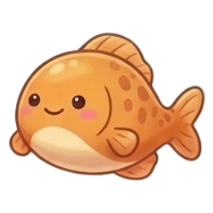

# AquaMerge: Cozy Ocean Aquarium 🌊

A cozy, relaxing physics-based sea creature merge puzzle game built for mobile and desktop browsers. Drop, roll, and merge aquatic friends—from tiny nudibranchs to majestic orcas—inside a serene, light blue sunlit aquarium.



## ✨ Features
- **Cozy Ocean Aesthetic**: Sunlit blue water gradient, soft coral sandbed, translucent ambient rising bubbles.
- **10 Animated Sea Creature Tiers**:
  1. 🌟 Nudibranch (Sea Slug)
  2. 🐟 Chubby Goldfish
  3. 🪸 Spiky Sea Urchin
  4. 🦞 Sweet Lobster
  5. 🐚 Spiral Nautilus
  6. 🌊 Moray Eel
  7. 🌸 Axolotl
  8. 🦦 Sea Otter with Clam
  9. 🦪 Giant Pearl Oyster
  10. 🐋 Majestic Orca
- **Living Character Eyes**: Sea creatures blink naturally with dedicated eye-state animation sprites.
- **Accurate Custom 2D Physics**: Substep collision resolution with zero wall jitter, deterministic apex deflection, and stable resting sleep states.
- **Juicy Merge FX**: Translucent rising bubbles with upward buoyancy and wobble, ripple rings, floating score counters, and combo celebration banners.
- **Web Audio FX**: Synthesized water pops, bubble bloops, bounce thuds, and merge jingles with toggleable sound.
- **Cozy Power-Ups**:
  - 📳 **Water Stir (Shake)**: Gently swirl and settle pieces.
  - 🫧 **Bubble Pop**: Remove the smallest creature to relieve pressure.

## 🚀 How to Run Locally
No build step or dependencies required! Simply serve the directory with any static file server:

```bash
# Using python
python3 -m http.server 8000

# Or using npx serve
npx serve .
```

Then open `http://localhost:8000` (or `http://localhost:3000`) in your browser.

## 📱 Mobile Friendly
Optimized for mobile touchscreens, PWA installable with manifest support, and responsive scaling.
